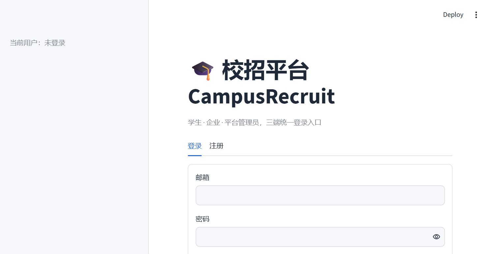
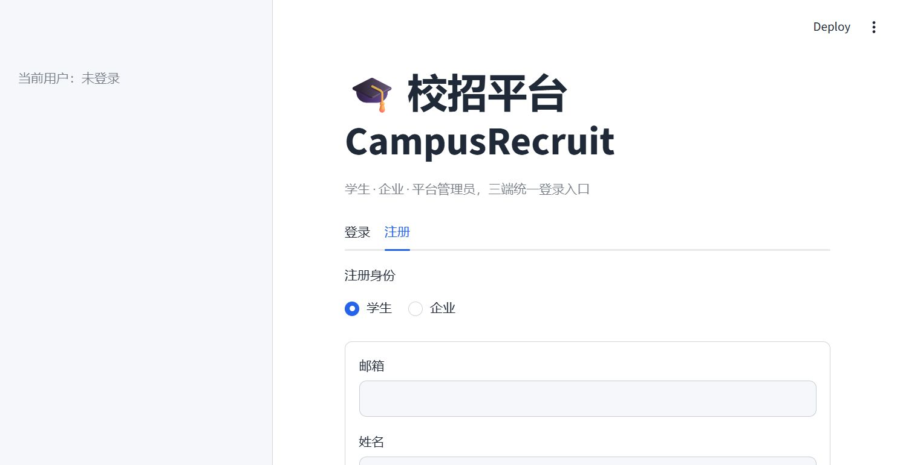
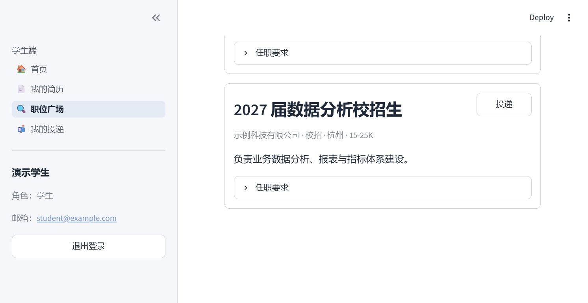
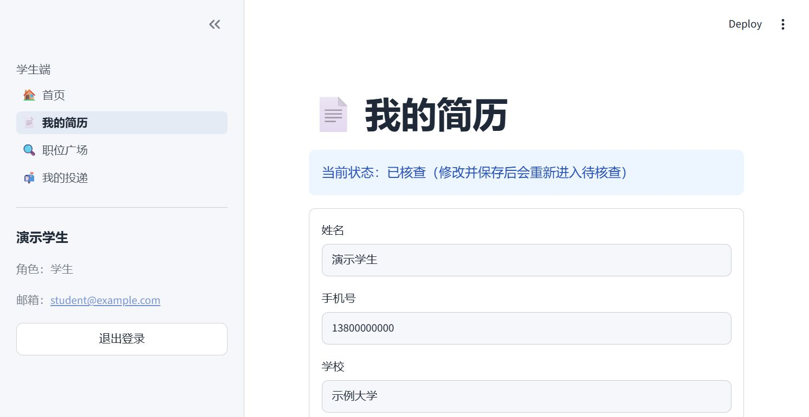
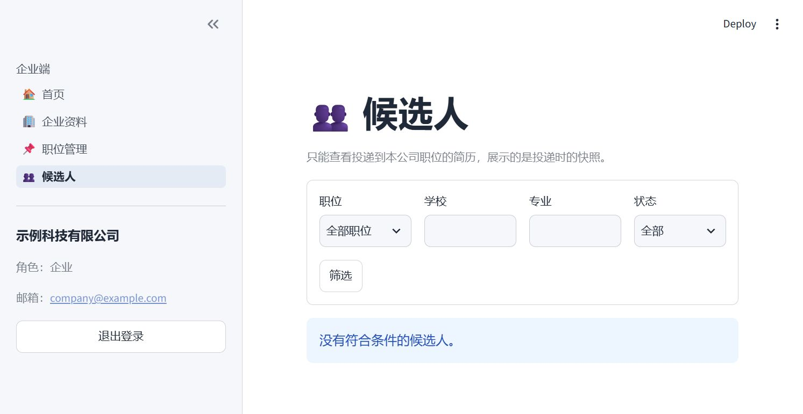
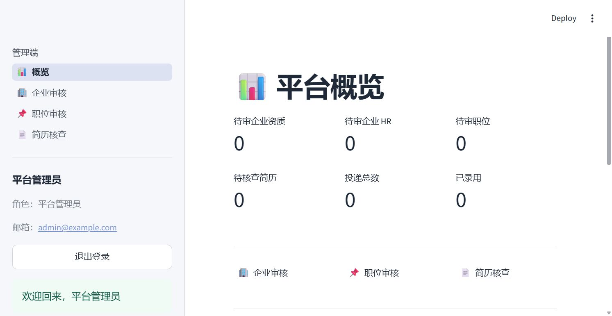

# 项目介绍文档

> 项目名称：校招平台 CampusRecruit
> 文档版本：v1.0（2026-11-18）
> 当前状态：三端功能、REST 接口、测试与本地运行均已完成；公网部署待执行
> 适用场景：课程项目答辩、项目评审、交付说明、演示开场

---

## 1. 一句话介绍

CampusRecruit 是一个基于 Python + Streamlit 的校园招聘与实习选拔平台，连接高校毕业生与招聘企业，通过**四层独立审核**保证企业、HR、职位与简历的真实性，并让学生在一个平台内完成“找岗位 → 投简历 → 看反馈”的闭环。

---

## 2. 产品定位

| 项 | 说明 |
|---|---|
| 产品类型 | 校招 / 实习双边匹配平台（MVP） |
| 目标用户 | 高校毕业生、招聘企业、平台运营管理员 |
| 核心价值 | 降低信息不对称，提高简历与岗位的匹配效率 |
| 交付形态 | 本地可运行的 Streamlit Web 应用，可选公网演示 |
| 技术定位 | 面向初学者的规格化工程项目，强调可读、可测、可追溯 |

---

## 3. 主要功能

### 3.1 学生端

| 功能 | 说明 |
|---|---|
| 注册与登录 | 邮箱注册，登录后进入学生专属导航 |
| 个人简历 | 维护姓名、学校、专业、毕业年份、技能、简介 |
| 附件上传 | 上传 PDF / DOCX 简历，限制 5 MB |
| 职位广场 | 按关键词、城市、类型（校招 / 实习）筛选已审核职位 |
| 投递职位 | 简历通过核查后可投递，同一职位只能投一次 |
| 投递反馈 | 查看“待查看 / 进入面试 / 已录用 / 不合适”及企业反馈 |

### 3.2 企业端

| 功能 | 说明 |
|---|---|
| 企业注册 | 提交企业名称、统一社会信用代码、营业执照 |
| HR 资料 | 提交 HR 姓名、企业邮箱、在职证明，接受独立审核 |
| 职位发布 | 企业资质与 HR 双审通过后，发布校招 / 实习职位 |
| 职位管理 | 编辑、关闭、重新开放；编辑后自动回到待审 |
| 人才筛选 | 按职位、学校、专业、状态筛选投递候选人 |
| 简历查看 | 查看投递时的简历快照并下载附件 |
| 候选人处理 | 查看 → 进入面试 → 录用 / 不合适，填写反馈 |

### 3.3 平台管理端

| 功能 | 说明 |
|---|---|
| 企业资质审核 | 查看营业执照，批准或拒绝企业资质 |
| 企业 HR 审核 | 独立审核 HR 身份，不影响资质状态 |
| 职位审核 | 审核职位真实性，通过后可推荐 |
| 简历核查 | 核查学生简历，通过后学生才可投递 |
| 企业维护 | 启用 / 停用企业账号 |
| 平台概览 | 待审企业、待审 HR、待审职位、待核查简历、投递总数、已录用数 |

---

## 4. 应用场景

| 场景 | 参与角色 | 平台如何解决 |
|---|---|---|
| 校招季集中招聘 | 企业 + 学生 | 企业发布校招职位，学生集中检索与投递 |
| 实习选拔 | 企业 + 学生 | 独立的实习职位类型，按城市与技能筛选 |
| 企业人才库 | 企业 | 在投递候选人中按学校、专业、状态筛选 |
| 平台内容治理 | 管理员 | 四层审核 + 审核日志，替代人工全量复核 |
| 课程项目演示 | 评审人 | 三类账号 + 演示数据，完整走通审核与投递闭环 |

---

## 5. 产品亮点

| 亮点 | 说明 |
|---|---|
| 四层独立审核 | 企业资质、企业 HR、职位、简历分别审核，任一环节不通过都无法进入下一阶段 |
| 投递快照 | 投递时保存简历内容与附件路径，学生后续修改不影响企业已收到的版本 |
| 三角色精简权限 | 学生、企业、管理员三端导航隔离，权限校验落在服务层 |
| 审核全程可追溯 | 每次审核记录审核人、决策、理由与时间 |
| 初学者友好 | 三层架构、页面 ≤ 250 行、运行时依赖少且版本固定 |
| 官方标准 | 使用 `st.Page` + `st.navigation`、官方配置、AppTest 测试 |

---

## 6. 产品截图

以下截图均来自真实运行界面（2026-11-18 本地运行采集）。

| 编号 | 页面 | 截图 |
|---|---|---|
| P-01 | 登录 / 注册 |  |
| P-02 | 学生注册 |  |
| P-03 | 学生端职位广场 |  |
| P-04 | 学生端我的简历 |  |
| P-05 | 企业端候选人 |  |
| P-06 | 管理员概览 |  |

---

## 7. 技术架构简述

```text
浏览器（Streamlit Client）        API 客户端 / Swagger
        │ WebSocket                     │ HTTP
        ▼                               ▼
app.py（路由 + 全局布局）        api/main.py（FastAPI）
        ▼                               ▼
views/（页面）──► services/（业务规则）──► core/（数据库 / 安全 / 配置）
                                              ▼
                                      SQLite + uploads/
```

| 层 | 职责 | 关键约束 |
|---|---|---|
| `views/` | 页面渲染与交互 | 不写 SQL、不写权限规则 |
| `api/` | REST 协议适配 | 只调用 `services/`，不写 SQL；自动生成 OpenAPI 3.1 |
| `services/` | 业务校验与状态流转 | 不导入 Streamlit / FastAPI，可被 pytest 直接测试 |
| `core/` | 数据库、密码、文件、配置 | 不依赖上层 |

REST 接口使用 JWT Bearer 认证，本地可通过 `http://localhost:8000/docs` 交互调试，契约文件为 `api/openapi.json`。

详细设计见 [技术设计与架构说明书](项目过程文档/03-技术架构说明书（含API设计、数据库设计）.md)。

---

## 8. 版本与访问方式

| 项 | 当前值 |
|---|---|
| 版本 | v1.2.0（v1.0 三端 + v1.1 品牌与求职升级 + v1.2 社区与急招） |
| 本地访问 | 页面 `http://localhost:8501`；REST 文档 `http://localhost:8000/docs` |
| 公网访问 | 待部署后填写（仅 Streamlit 页面，不含 REST） |
| 访问二维码 | 待公网地址确定后生成 `docs/images/access-qr.png` |
| 演示账号 | 见 [README](../README.md#演示账号) |

> 部署到 Streamlit Community Cloud 时，`data/app.db` 与 `uploads/` 不保证持久化，公网版本仅用于演示。长期在线需替换为托管数据库与对象存储。Community Cloud 只能运行一个 Streamlit 进程，因此公网地址不提供 REST 接口。

---

## 9. 项目状态

| 阶段 | 状态 | 说明 |
|---|---|---|
| 需求与规格 | ✅ | 需求搜集清单、Spec 完成 |
| 技术设计 | ✅ | TDD 含 API 与数据库设计 |
| 评审 | ✅ | P0/P1 问题全部关闭 |
| 代码实现 | ✅ | M1-M4.5：三端 + REST 全部完成 |
| 测试 | ✅ | 146 个自动化测试，四项质量门禁通过 |
| 截图 / 打包 | ✅ | 6 张真实截图，代码包已生成并验证 |
| 公网部署 / 二维码 | ⏳ | 需可用托管账号后执行 |

---

## 10. 适用与限制

**适用：**

- 课程项目、毕业设计、Streamlit 学习项目；
- 小规模校招/实习流程演示；
- 需要展示“规格驱动开发 + 四层审核”的工程案例。

**限制：**

- 单机 SQLite，不适合高并发生产；
- 本地文件存储，云端重启可能丢失数据；
- 无邮件/短信通知，反馈需页面刷新查看；
- 认证为会话级，公网应升级为官方 `st.login()` OIDC。

---

## v1.1 升级亮点（2026-11-18）

- **企业品牌露出**：企业可维护 logo、简介、文化、行业、规模、融资、城市与福利，学生在岗位列表和详情页即可看到完整品牌信息。
- **精准求职**：多关键词 AND 搜索、仅标题搜索、岗位类别 / 城市 / 类型组合筛选，以及推荐优先、最新发布、薪资优先三种排序。
- **智能推荐**：基于简历技能、专业与城市偏好加权评分，逐条给出命中理由，并自动排除已投递职位。
- **相似职位**：详情页推荐同类目、同城市、关键词重合的岗位，帮助学生发现更多机会。
- **批量投递**：勾选多个职位一键投递，单次最多 20 个，逐条反馈成功与失败原因。
- **求职辅助**：岗位收藏、我的收藏、已投递标记、独立职位详情页与学生首页快捷入口。
- **视觉升级**：统一色彩与组件规范、渐变主视觉、品牌化侧边栏、移动端响应式适配。
- **工程保障**：新增 8 条自动化用例，全量 121 条测试通过；REST 接口升级至 1.1.0 并同步 OpenAPI 契约。

---

## v1.2 升级亮点（2026-11-20）

- **急招专区**：企业可为已通过职位设置 1-30 天急招，占比不超过 30%，独立入口展示剩余天数，到期自动失效。
- **企业文化交流区**：在职 / 曾任职 / 实习过用户分享真实体验，未任职只能提问；支持匿名、先审后发，企业可官方回应。
- **企业评分**：成长、薪酬、强度、面试、推荐意愿五维评分，简历核查后可评；样本少于 3 条不展示分数，达标后进入推荐理由。
- **小任务兼职**：展会协助、活动执行等短期任务独立入口，关键词拦截刷单 / 押金 / 垫付，先审后发、报名制、平台不碰资金。
- **招聘看板**：企业按职位查看浏览、投递、面试、录用、转化率与平均响应时长，用数据判断招聘效果。
- **候选人匹配**：按技能命中、专业、城市偏好排序候选人，展示匹配分与可解释理由，可一键关闭。
- **企业主页**：聚合官方品牌、在招职位、员工分享与员工评分，形成企业信用资产。
- **内容治理**：管理端新增文化帖、企业评分、小任务三合一审核队列，先审后发、违规可拒绝。
- **工程保障**：新增 25 条自动化用例（12 条功能 + 13 条边界 / 异常），全量 146 条测试通过；REST 接口升级至 1.2.0 并同步 OpenAPI 契约。

